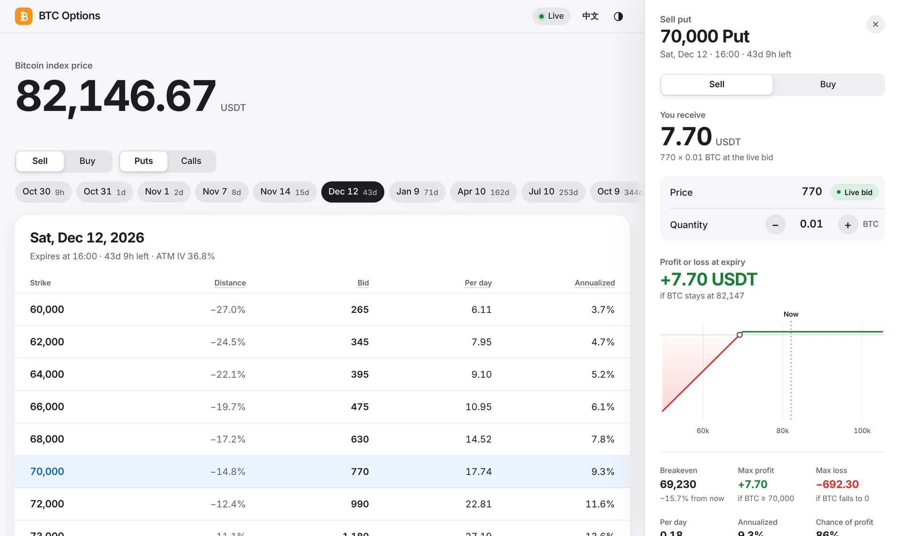

# BTC Options

A live Binance BTC options board that runs on your own computer, built around one question: **which option pays the most per day for the risk I'm taking?**

<picture>
  <source media="(prefers-color-scheme: dark)" srcset="docs/preview-dark.webp">
  
</picture>

## Start

Needs Python 3.9 or newer.

```bash
python -m pip install -r requirements.txt
```

```bash
python server.py
```

Your browser opens <http://127.0.0.1:8765>. On Windows you can double-click `启动期权看板.bat` instead. Running it again while the dashboard is already open simply reopens the page.

## Using it

- **Choose what to trade.** Sell or Buy, Puts or Calls, then a date. Every strike shows how far it is from the index price, the bid (or ask), the premium per day and its annualized yield (or breakeven when buying). The blue line marks where BTC trades now.
- **Click a strike** to see the trade: the premium for your quantity, breakeven, maximum profit and loss, the chance of profit implied by volatility, and the profit or loss at expiry. Drag across the chart to read any settlement price. Type a price to try a limit order; "Use live price" goes back to the market.
- **Keyboard:** ↑ ↓ move between strikes, ← → between dates, Esc closes the panel.

Prices are per 1 BTC, as Binance quotes them. Figures assume you hold to expiry and leave out fees; Binance settles on the average index over the last 30 minutes. The dashboard only reads public market data. It needs no API key and never places orders.

## How it works

`market.py` keeps a single WebSocket to Binance, `btcusdt@optionMarkPrice`, which carries the best bid and ask, mark price, IV, Greeks and the index for every contract each second. REST loads the contract list, refreshes it every five minutes and takes over every 15 seconds if the stream drops. `server.py` serves `web/` on 127.0.0.1 only and pushes each update to open tabs with server-sent events. The page is plain HTML, CSS and JavaScript; `web/payoff.js` holds the payoff math.

## Tests

```bash
python -m unittest discover -s tests
```

```bash
node --test tests/payoff.test.js
```

---

# BTC 期权

在本机运行的币安 BTC 期权实时看板，帮你回答一个问题：**承担同样的风险，哪个期权每天收的权利金最多？**

## 启动

需要 Python 3.9 或更新版本。先安装依赖：`python -m pip install -r requirements.txt`，然后运行 `python server.py`，或在 Windows 中双击 `启动期权看板.bat`。浏览器会打开 <http://127.0.0.1:8765>；看板已在运行时再次启动，只会重新打开页面。

## 使用

- **选择交易**：卖出或买入、Put 或 Call，再选到期日。每个行权价显示距现价、买价（买入时为卖价）、每日权利金和年化收益（买入时为盈亏平衡价）。蓝线标出 BTC 当前价格。
- **点击行权价**查看这笔交易：按你的数量计算的权利金、盈亏平衡价、最大盈利和亏损、按隐含波动率估算的盈利概率，以及到期盈亏曲线。在曲线上拖动可查看任意结算价的盈亏。输入价格可试算限价单，“恢复实时价”回到盘口价格。
- **键盘**：↑ ↓ 切换行权价，← → 切换到期日，Esc 关闭面板。

价格均为每 1 BTC 的报价，与币安一致。计算假设持有到期，未计手续费；币安按到期前 30 分钟的指数均价结算。看板只读取公开行情，不需要 API Key，也不会下单。界面会按浏览器语言自动显示中文或英文，右上角可以切换语言和深浅色外观。
